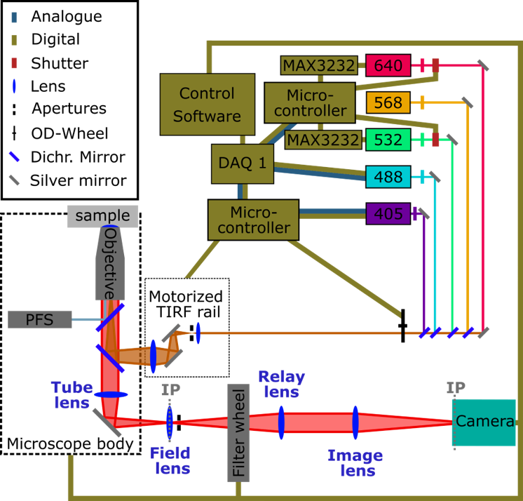

# Automated SMLM microscope
Here we describe a custom build SMLM extension of a Nikon Ti-E microscope, for TIRF high throughput SMLM measurements. For fast screening an additional RCM 1 unit is attached to the left port of the microscope. The whole setup is controlled with NIS Elements extended by [NIS Elements macros](https://github.com/Rickmic/Receptor_Quantification/tree/main/high_throughput_microscopy/NIS_macro). Additional three Arduino Mega microcontrolers are attached to the microscope ([Arduino scripts](https://github.com/Rickmic/Receptor_Quantification/tree/main/high_throughput_microscopy/Arduino)). One Arduino controls the TIRF translational stage, and pulses the UV lasers. Another Arduino modulates the DPSS Lasers via RS232 and controls the Neutral density wheel attached to a servo motor. The third Arduino controls the costum build piezo slider system in the RCM box. All arduinos are connected to NIS elements via a NiDaq card and communicate with NIS elements over digital and analogue signals.

 <b>SMLM part of the ht-Setup</b>

# Data analysis
Additionally we provide python scripts to reconstruct objective scanned 3D SMLM data acquired with the 3D beampath of this microscope.

